# Assignment B — Durable Campaign Dispatcher

## Implementation choice

I implemented the dispatcher as a **PostgreSQL-backed state machine** rather than introducing a separate workflow engine. The core problem is coordinating a durable decision to place a call with an external provider whose response can be lost or ambiguous. PostgreSQL transactions, unique indexes, advisory locks, and persisted request IDs provide the primitives needed for this assignment without an additional service to operate.

## Lead lifecycle

```mermaid
stateDiagram-v2
    [*] --> pending
    pending --> requesting: reserve + persist request_id
    retry_wait --> requesting: retry due
    callback_wait --> requesting: callback due
    requesting --> accepted: provider 200/201 or reconciliation
    requesting --> unknown: timeout / ambiguous 504
    requesting --> retryable: definite 503 / safe pre-dial deferral
    unknown --> accepted: provider lookup finds call
    unknown --> requesting: lookup confirms no call; replay same request_id
    retryable --> requesting: transport retry becomes due
    accepted --> ended: authenticated webhook or provider polling
    ended --> completed: terminal disposition
    ended --> retry_wait: no_answer / busy / failed with attempts remaining
    ended --> callback_wait: callback_requested
    ended --> exhausted: attempt limit reached without terminal disposition
    pending --> dnd_blocked: another campaign opts out this phone
    retry_wait --> dnd_blocked: global DND
    callback_wait --> dnd_blocked: global DND
    completed --> [*]
    exhausted --> [*]
    dnd_blocked --> [*]
```

## Correctness mechanisms

- **Persist before side effect:** a reservation transaction changes the lead to `dialing` and stores a deterministic request ID before the provider is contacted. A process crash cannot erase the identity of the request that may have reached the provider.
- **Ambiguous outcomes:** a timeout or 504 is not treated as a failed call. The dispatcher queries by the same request ID and, only after confirming the provider has no record, retries with that same ID. A provider-accepted call is counted once.
- **Shared tenant limit:** reservations lock the tenant row before checking and incrementing the durable active-attempt set. The lock is shared by all campaigns for the tenant.
- **One active call per phone:** a retained `phone_guards` row serializes reservations and call-result/DND transitions. A partial unique index over active attempts is a second database-level invariant.
- **Global DND:** result processing records DND by keyed phone token and moves all other non-terminal leads with the same token to `dnd_blocked`. Completed/exhausted states are preserved according to the required precedence.
- **Webhook security and idempotency:** the exact raw body is authenticated with HMAC-SHA256 and constant-time comparison. A delivery ID/body hash and the corresponding state transition are written in one transaction. Duplicate deliveries with the same body are harmless; reuse of an ID with another body is rejected.
- **Lost-webhook recovery:** accepted attempts are polled by provider call SID. Unresolved requests are looked up by request ID. This covers a process crash between reservation, provider acceptance, API response handling, and webhook delivery.
- **Calling windows and priority:** all business timing uses the provider clock. Clock epoch metadata is used to project the provider time to the next HTTP POST handoff, avoiding a stale-clock decision at 600× speed. Due callbacks are scheduled before retries, then fresh leads; same-priority work is submitted concurrently only up to remaining tenant capacity.
- **PII protection:** phone numbers and names are encrypted at rest; phone matching, active-phone uniqueness, and DND use a keyed HMAC token. Raw provider result payloads are allowlisted before persistence so the phone is not copied into the result snapshot.
- **Deadlock handling:** webhook processing acquires the phone guard before inserting a row with a foreign key to `attempts`, matching the transition/reservation lock order. Safe repository transactions retry after PostgreSQL deadlock/serialization aborts; provider requests are never inside those transactions.

## Validation plan

The required validation is:

1. Run the full pytest suite with `TEST_DATABASE_URL` set to PostgreSQL. The integration tests each use an isolated schema.
2. Run the mock provider with failure injection disabled and verify `final_state.csv` against `/admin/leads`; `/admin/report` must show zero violations and no active calls.
3. Repeat with the provider's default failure scale to exercise 503s, ambiguous 504s, duplicate/missing webhooks, and reconciliation.
4. Kill and restart the dispatcher while preserving both the provider process and the PostgreSQL database; verify the final output again.
5. Review callback lateness and observed concurrency in `/admin/report`.

A passing unit-test suite alone is not evidence that the external provider run, unseen-seed evaluation, or process-kill recovery has passed. Those must be confirmed by actual integration results before submission.

## Validation actually performed

The following results were obtained locally against the supplied mock provider and PostgreSQL. The detailed verifier summaries are checked in under `verification-evidence/`.

| Check | Observed result |
|---|---|
| PostgreSQL-backed automated suite | 75 passed |
| Python compilation | `python -m compileall -q solution` exited 0 |
| Full clean provider run | 200 leads; 407 accepted attempts; 200 CSV rows; exact provider match; 0 mismatches; 0 provider violations; 0 active calls |
| Full failure-injection run (seed 42, failure scale 1) | 200 leads; 408 accepted attempts; 200 CSV rows; exact provider match; 0 mismatches; 0 provider violations; 0 active calls |
| One-lead process-kill/restart smoke test | Dispatcher was killed while the provider reported one active call; restart reconciled the same call; one accepted attempt; exact one-row CSV match; 0 provider violations; 0 active calls |

Observed maximum tenant concurrency was 4 for `acme_insurance` and 3 for `zen_retail`, within the fixture limits.

### Performance observation and verification boundary

The failure-injection run reported callback lateness p50 **10.5 minutes**, p90 **37.1 minutes**, and max **3,836.9 minutes**. The maximum is a significant tail outlier and should be investigated as a scheduling-performance concern; it did not coincide with a provider rule violation in that run. The clean run's maximum callback lateness was **72.7 minutes**.

The live process-kill test used the dedicated one-lead fixture. It demonstrates recovery of an in-flight provider call after one dispatcher termination, but it is not a repeated crash campaign across the full 200-lead workload. These results describe the specific local runs recorded here; they do not guarantee every unseen seed, arbitrary crash timing, or external grading environment.
